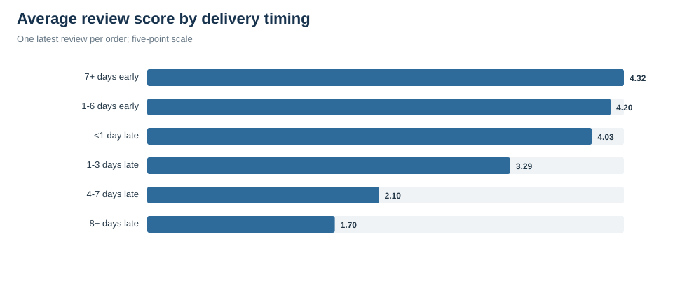
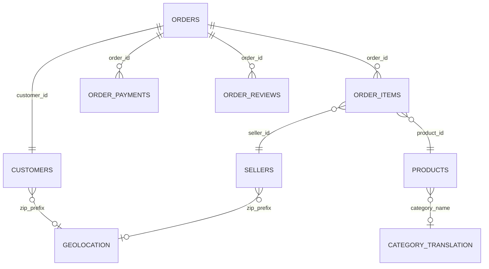
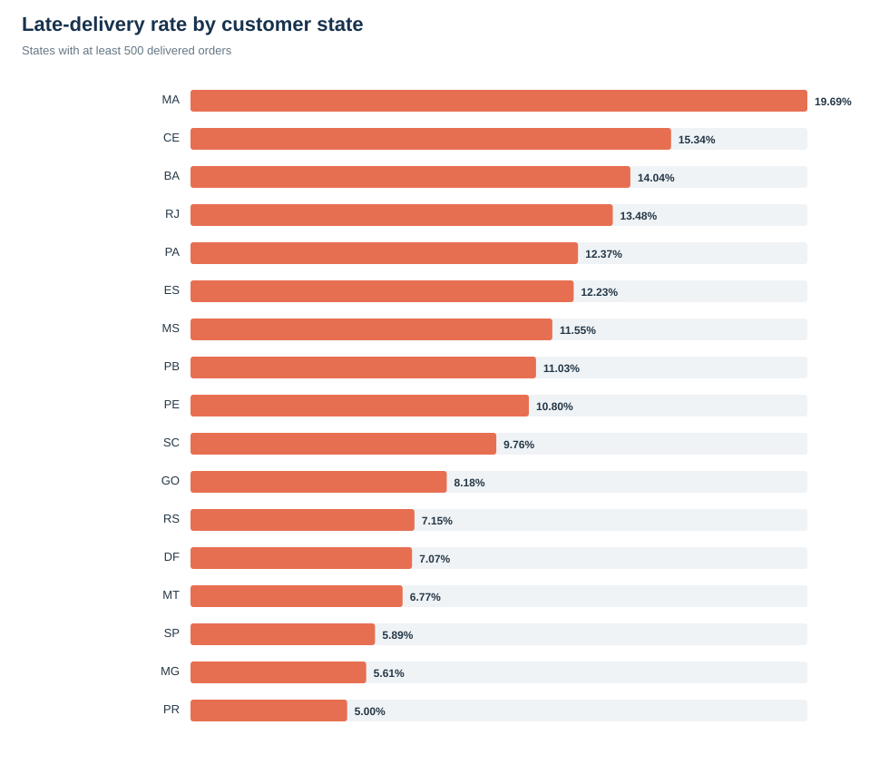
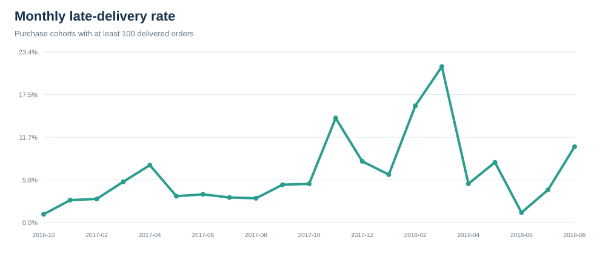

# Olist配送パフォーマンス分析

ブラジルのEC公開データを用いて、配送遅延と顧客評価の関係、遅延が起きやすい物流セグメント、改善すべき工程をDuckDB SQLで分析したポートフォリオです。



## エグゼクティブサマリー

- 分析対象は、配送完了かつ主要な配送日時がすべて記録された **96,455注文** です。
- 到着予定時刻を超過した注文は **8.11%** でした。
- 期限内注文の平均レビューは **4.29**、遅延注文は **2.56** で、1.73ポイントの差がありました。
- 1,500km以上の長距離注文の遅延率は **13.06%** で、250km未満の **6.30%** の約2.1倍でした。
- 州をまたぐ注文の遅延率は **9.26%**、同一州内は **6.06%** でした。
- 10kg以上の注文の遅延率は **10.12%** で、1kg未満の **7.82%** より2.30ポイント高い結果でした。
- 遅延注文は配送業者への引き渡し後から到着まで平均 **25.68日**、期限内注文は **7.89日** でした。因果は断定できませんが、配送業者引き渡し後の工程は優先的な監視対象です。
- 「商品数が多い注文ほど遅延しやすい」という仮説は支持されませんでした。3商品以上の遅延率は **6.20%**、1商品の注文は **8.29%** でした。

## 1. 課題設定

### ビジネス課題

ECでは、配送完了率だけでは顧客体験を十分に評価できません。注文が最終的に届いても、約束した予定日を過ぎればレビュー低下、問い合わせ増加、再購入意向の低下につながる可能性があります。

そこで本分析では、次の問いを設定しました。

> 配送予定日の超過を減らすために、どの工程・地域・注文特性を優先して改善すべきか。

### 分析KPIと役割

| KPI | 定義 | 役割 |
|---|---|---|
| 予定日超過率 | `delivered_customer_timestamp > estimated_delivery_timestamp` の注文割合 | 顧客との約束を守れたかを示す主KPI |
| 配送日数 | 購入から顧客到着までの時間 | リードタイム全体を把握する |
| 出荷準備日数 | 注文承認から配送業者への引き渡しまで | 出品者側・出荷側の工程を把握する |
| 運送日数 | 配送業者への引き渡しから顧客到着まで | 配送業者側・輸送側の工程を把握する |
| 平均レビュー | 最新レビューの5段階評価の平均 | 顧客体験との関連を確認する |
| 低評価率 | レビュー2以下の注文割合 | 強い不満が発生した注文を捉える |

## 2. 仮説

| ID | 仮説 | 比較結果 | 判定 |
|---|---|---:|---|
| H1 | 遅延注文は期限内注文よりレビューが低い | 2.56 vs 4.29 | 支持。ただし関連であり因果ではない |
| H2 | 長距離配送は近距離配送より遅延率が高い | 13.06% vs 6.30% | 支持。未調整比較 |
| H3 | 重い注文は軽い注文より遅延率が高い | 10.12% vs 7.82% | 支持。未調整比較 |
| H4 | 商品数が多い注文は遅延率が高い | 6.20% vs 8.29% | 不支持 |
| H5 | 州をまたぐ配送は同一州内より遅延率が高い | 9.26% vs 6.06% | 支持。未調整比較 |
| H6 | 遅延注文は配送業者引き渡し後の所要日数が長い | 25.68日 vs 7.89日 | 支持。ただし関連であり因果ではない |

仮説の集計値は [`sql/09_hypothesis_summary.sql`](sql/09_hypothesis_summary.sql) で再現できます。

## 3. データ設計

元データは [Brazilian E-Commerce Public Dataset by Olist](https://www.kaggle.com/olistbr/brazilian-ecommerce/) です。CSV本体は容量と再配布条件への配慮からリポジトリに含めていません。



### 注文単位マートにした理由

`order_items`、`order_payments`、`order_reviews` は1注文に複数行を持つ可能性があります。これらを明細のまま同時に結合すると、行同士が掛け合わされ、注文数・売上・送料が水増しされます。

そのため [`sql/00_build_mart.sql`](sql/00_build_mart.sql) では、次の順序で加工しています。

1. 商品明細、支払い、レビューをそれぞれ注文単位へ集約する。
2. レビューが複数ある場合は、回答日時が最も新しい1件を採用する。
3. 複数出品者の注文では、商品価格と送料の合計が最大の出品者を代表出品者とする。
4. 商品カテゴリが複数ある場合は、商品金額が最大のカテゴリを代表カテゴリとする。
5. 郵便番号ごとの緯度・経度平均から、顧客と代表出品者の直線距離を概算する。
6. 配送完了かつ主要日時が揃った注文だけを分析マートに含める。

この設計により、最終マートは **1注文1行** です。品質チェックでは96,455行、ユニーク注文96,455件、重複0件を確認しています。

## 4. 分析結果と理由

### 4.1 遅延とレビューには強い関連がある

| 配送タイミング | 注文数 | 平均レビュー | 低評価率 |
|---|---:|---:|---:|
| 7日以上早着 | 71,073 | 4.32 | 8.98% |
| 1〜6日早着 | 17,076 | 4.20 | 10.25% |
| 1日未満の遅延 | 1,280 | 4.03 | 12.42% |
| 1〜3日遅延 | 1,852 | 3.29 | 32.13% |
| 4〜7日遅延 | 1,747 | 2.10 | 67.72% |
| 8日以上遅延 | 2,781 | 1.70 | 79.29% |

遅延が長くなるにつれて、平均レビューは段階的に下がり、低評価率が上がっています。特に4日を超える遅延から低評価が急増しています。

考えられる理由は、配送予定日が顧客の期待値として機能するためです。ただし、破損・誤配送・商品品質など、データに含まれない要因もレビューへ影響します。この集計だけで遅延の因果効果とは断定できません。

### 4.2 長距離・州間配送は遅延リスクが高い



- 1,500km以上の遅延率は13.06%、250km未満は6.30%でした。
- 州間配送の遅延率は9.26%、同一州内は6.06%でした。
- 500件以上ある州では、MAが19.69%、CEが15.34%、BAが14.04%、RJが13.48%でした。一方、SPは5.89%でした。

距離が長く州をまたぐ配送では、中継拠点・担当業者・移動区間が増える可能性があります。その結果、各工程のばらつきが積み上がると考えられます。ただし、州差には距離以外のインフラ、配送業者構成、商品構成、時期も含まれるため、多変量調整前の優先順位づけとして使用します。

### 4.3 遅延注文では運送工程が大きく長期化する

| 配送状況 | 約束された日数 | 出荷準備日数 | 運送日数 | 全配送日数 |
|---|---:|---:|---:|---:|
| 期限内・早着 | 23.91 | 2.58 | 7.89 | 10.88 |
| 遅延 | 21.98 | 5.32 | 25.68 | 31.52 |

遅延注文は、出荷準備が2.74日長く、配送業者引き渡し後の運送が17.79日長い結果でした。さらに遅延注文の約束日数は平均で約2日短く、実際には長い物流時間が必要な注文へ、相対的に短い予定日が設定されていた可能性があります。

したがって、改善対象は「配送を速くする」だけではありません。実績に合わせて予定日を補正すること、出荷前から遅延リスクを検知すること、引き渡し後の滞留を監視することの3つが必要です。

### 4.4 重量は遅延リスクと関連する

10kg以上の注文は遅延率10.12%、1kg未満は7.82%でした。重量物は利用できる配送網、積載、取り扱い工程が制約される可能性があります。

カテゴリ別では、500件以上のカテゴリのうち `office_furniture` は平均配送日数20.67日、平均レビュー3.65、平均重量15.15kgでした。遅延率だけでなく、長い配送日数と低い評価が同時に見られるため、重量物カテゴリの重点監視候補です。

### 4.5 商品数の多さは遅延仮説を支持しなかった

3商品以上の注文の遅延率は6.20%で、1商品の8.29%より低い結果でした。商品数だけでは遅延リスクを説明できません。

一方、複数商品注文の平均レビューは低く、2商品で3.69、3商品以上で3.46でした。これは分割配送、欠品、商品品質などの可能性がありますが、本データだけでは理由を特定できません。配送遅延とは分けて追加調査するべき論点です。

### 4.6 月ごとの変動が大きい



2017年11月は14.31%、2018年2月は15.99%、2018年3月は21.36%まで上昇しました。繁忙期、地域構成、配送網の障害などが候補ですが、このデータだけでは変動理由を断定できません。

月次監視では、単純な前月比だけでなく、注文数・州・距離・重量・カテゴリ構成を併せて確認する必要があります。

## 5. 改善提案

| 優先度 | 改善施策 | 何を行うか | 主なKPI |
|---:|---|---|---|
| 1 | 配送リスクの早期警告 | 距離、州間配送、重量、出荷準備の遅れ、購入月を用いて高リスク注文を出荷前に抽出する | 予定日超過率、8日以上遅延率 |
| 2 | 配送業者・ルート別SLA管理 | 出品者州×顧客州×配送業者単位で運送日数の中央値とP90を監視する | 運送日数、P90配送日数 |
| 3 | 到着予定日の再推定 | 州、距離帯、重量帯、カテゴリ、季節の実績分布から約束日を補正する | 予定日内到着率、予定誤差 |
| 4 | 重量物カテゴリの専用運用 | 家具など重量物を通常商品と分け、対応可能な配送網と長めの予定日を設定する | 重量物遅延率、カテゴリ別レビュー |
| 5 | 遅延時の先回り連絡 | 遅延見込み時に更新予定日と問い合わせ・キャンセル選択肢を提示する | 遅延注文の低評価率、問い合わせ率 |

### 実施順序の理由

最初に早期警告とSLA監視を行う理由は、既存オペレーションを大きく変更せず、遅延が発生する場所を測定できるためです。次に予定日の推定精度を上げ、顧客への約束を現実的にします。重量物の専用運用は配送網や契約変更を伴うため、対象カテゴリとルートを特定してから実施します。

## 6. SQLで実装した内容

- 1対多テーブルを先に集約し、結合による重複を防止
- `ROW_NUMBER()` と `QUALIFY` による最新レビュー・代表出品者の選択
- `FILTER` 付き集計による仮説比較
- `DATE_DIFF` による工程別リードタイム計算
- Haversine式による郵便番号間距離の概算
- Window関数による構成比計算
- 品質チェックによる注文重複、欠損、異常期間の確認

主要なSQLは次の役割に分かれています。

| ファイル | 役割 |
|---|---|
| [`00_build_mart.sql`](sql/00_build_mart.sql) | CSV読込、集約、結合、派生指標の作成 |
| [`01_kpis.sql`](sql/01_kpis.sql) | 全体KPI |
| [`02_delay_review.sql`](sql/02_delay_review.sql) | 遅延日数とレビューの関係 |
| [`03_monthly_trend.sql`](sql/03_monthly_trend.sql) | 月次推移 |
| [`04_state_performance.sql`](sql/04_state_performance.sql) | 顧客州別の配送実績 |
| [`05_driver_segments.sql`](sql/05_driver_segments.sql) | 距離・州間・重量・商品数の比較 |
| [`06_category_performance.sql`](sql/06_category_performance.sql) | カテゴリ別の配送実績 |
| [`07_process_stage.sql`](sql/07_process_stage.sql) | 出荷準備と運送工程の分解 |
| [`08_quality_checks.sql`](sql/08_quality_checks.sql) | マート品質検証 |
| [`09_hypothesis_summary.sql`](sql/09_hypothesis_summary.sql) | 仮説の比較値と判定 |

## 7. 再現方法

### 必要なもの

- DuckDB CLI
- Python 3。グラフ生成は標準ライブラリだけを使用します。
- Olistの9個のCSVファイル

### 実行

```bash
git clone <this-repository-url>
cd olist-delivery-portfolio
./scripts/run_analysis.sh /path/to/olist_delivery_dataset
```

実行すると、次の成果物が更新されます。

- `olist_analysis.duckdb`: 注文単位の分析マート。Git管理対象外です。
- `results/*.csv`: 各SQLの集計結果。
- `assets/*.svg`: READMEとWebページで使用するグラフ。
- `docs/index.html`: GitHub Pages向けの静的ポートフォリオ。

## 8. データ品質と制約

- 注文マートの重複注文は0件です。
- レビュー欠損は0.67%、距離欠損は0.50%です。
- 顧客・出品者間距離は、郵便番号ごとの代表座標を使った直線距離です。実際の走行距離ではありません。
- 複数出品者・複数カテゴリの注文は代表値に単純化しています。
- 支払総額と商品金額＋送料には全体で2,688.02 BRLの差があります。クーポン、調整、丸め、データ定義差などが候補ですが、このデータだけでは理由を特定できません。
- 本分析は観察データの単純比較です。季節、地域、カテゴリなどを統制した因果推論ではありません。
- Olistの実運用中の配送業者名や配送センター情報は含まれないため、具体的な責任主体までは特定できません。

## 9. リポジトリ構成

```text
.
├── assets/                 # SVGグラフ
├── data/                   # CSV配置用。CSVはGit対象外
├── docs/index.html         # GitHub Pages用の分析ページ
├── results/                # SQL出力
├── scripts/
│   ├── generate_assets.py  # SVGとHTMLを生成
│   └── run_analysis.sh     # 全処理の実行入口
└── sql/                    # マート作成・分析・品質検証SQL
```

## データ出典

[Brazilian E-Commerce Public Dataset by Olist](https://www.kaggle.com/olistbr/brazilian-ecommerce/)

## License

分析コードは [MIT License](LICENSE) です。元データには配布元の条件が適用されます。

